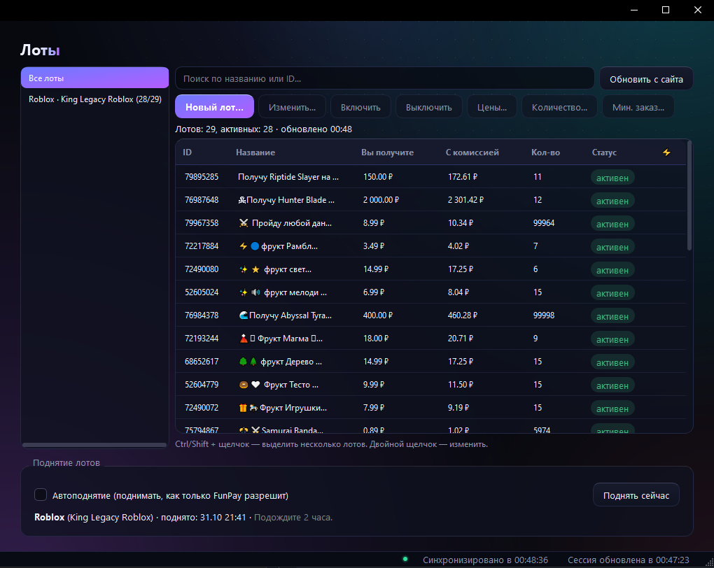
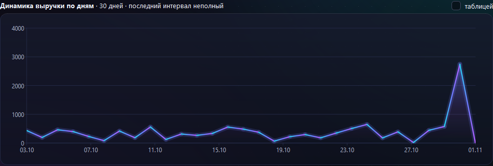
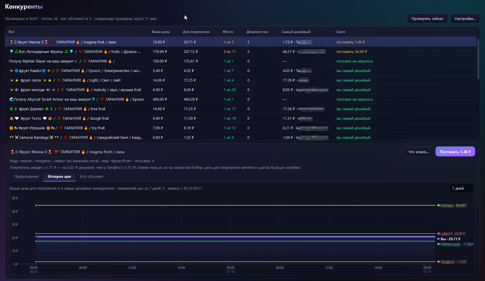
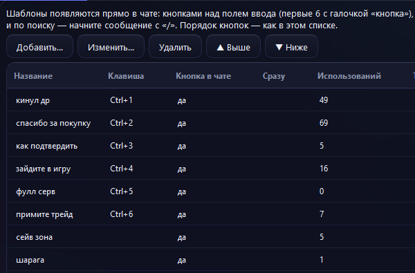
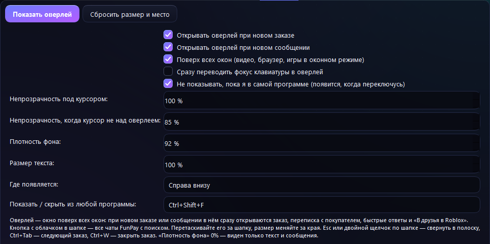

# FunPay Desk

Десктопная программа для продавцов FunPay на Windows. Чаты, заказы, лоты, массовая смена цен, статистика и прибыль, автоответы, быстрые ответы и управление с телефона через Telegram.

> ⚠️ Это неофициальный клиент. FunPay его не разрабатывал и не одобрял. Автоматизация может нарушать правила площадки, поэтому вы используете программу на свой риск.

## Скриншоты

### Лоты
Все свои лоты с ценами и статусами. Массовые действия: включить или выключить, изменить цены, поменять количество.

### Статистика
Динамика выручки по дням и разрезы по лотам и категориям.

### Конкуренты
Место вашей цены среди похожих предложений, самый дешёвый продавец и подсказка, какую цену поставить, чтобы стать первым.

### Быстрые ответы
Шаблоны с горячими клавишами Ctrl+1…9, переменные {name}, {product}, {nick} и кнопки прямо над полем ввода в чате.

### Оверлей заказа
Окно поверх всех игр, видео и браузера: при новом заказе или сообщении показывает заказ и переписку. Прозрачность, размер и горячая клавиша настраиваются.

## Скачать и купить

Программа продаётся по подписке. Установщик и ключ выдаются только после оплаты.

- Telegram-канал с новостями, обновлениями и покупкой: **https://t.me/+3GUrsPb9pf04MWNi**

Цены: 1 месяц — 200 ₽, 1 год — 1500 ₽.

## Вопросы

Пишите в Telegram-канал выше. Там же публикуются обновления.
